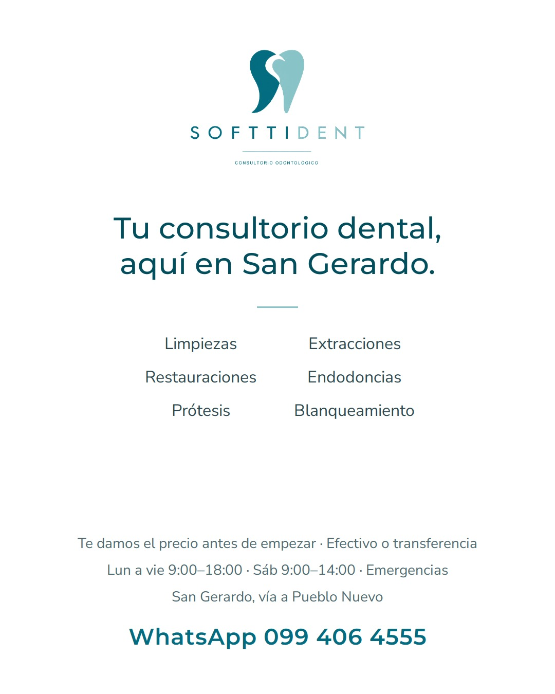
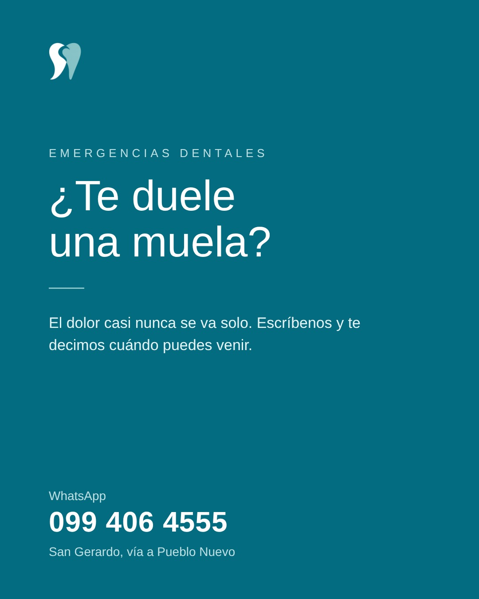
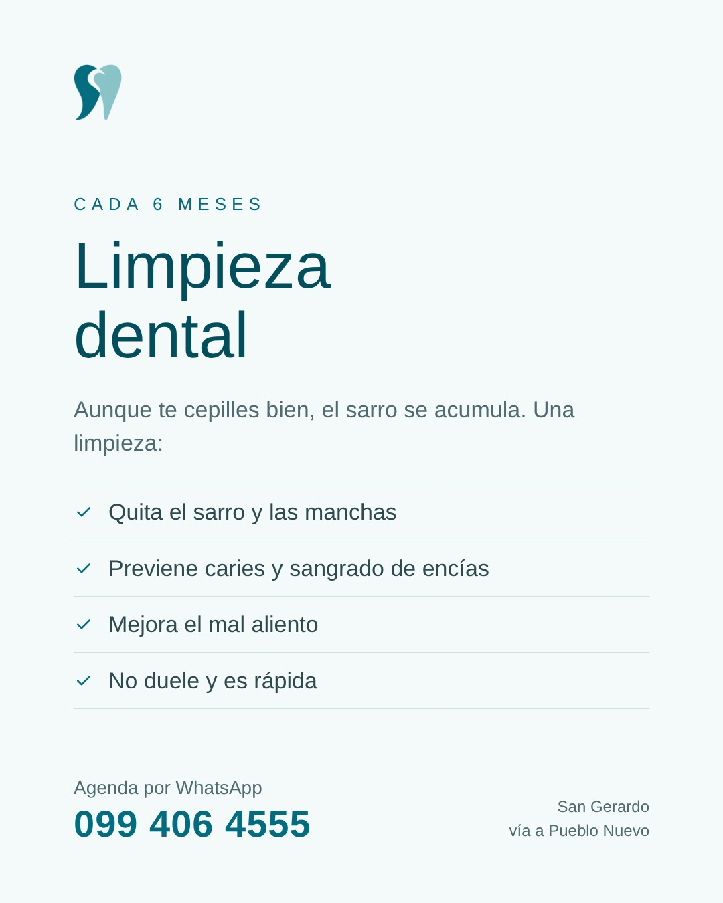
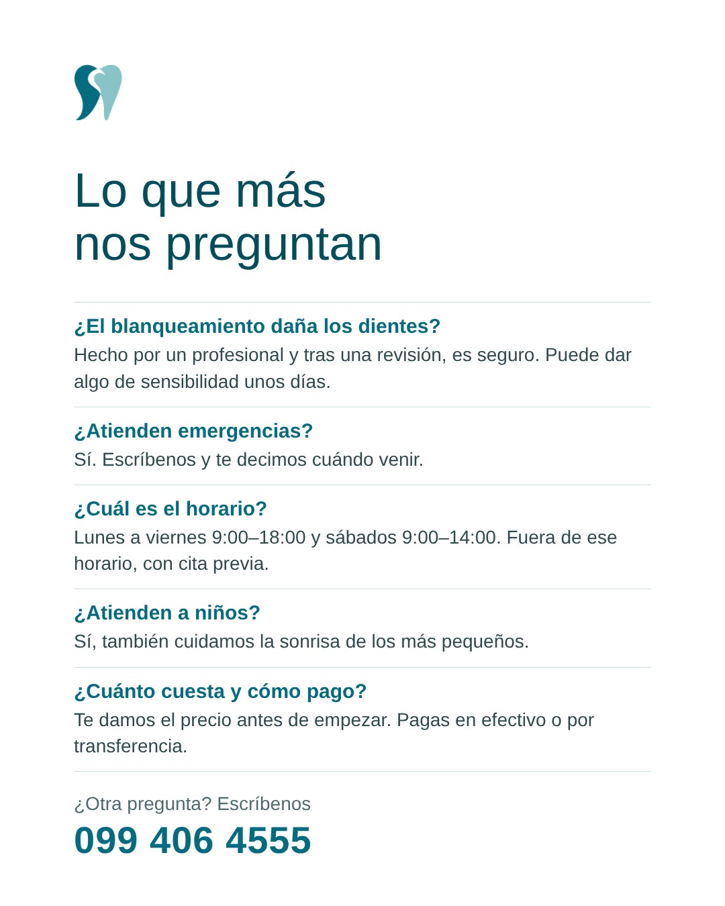

# Publicar a mano en Instagram

Para cada publicación de abajo:

1. Toca **Descargar imagen** y guárdala en el celular (mantén presionada la imagen → *Descargar* o *Guardar*).
2. En Instagram: **+** → **Publicación** → elige la imagen → **Siguiente**.
3. Copia el texto (botón de copiar del recuadro gris) y pégalo.
4. **Más opciones** → **Programar esta publicación** → elige la fecha y la hora indicadas → **Programar**.
5. Revisa tus programadas en tu perfil → ☰ → **Contenido programado**.

Esta hoja muestra solo lo aprobado de hoy en adelante. No sabe qué ya programaste:
revísalo en **Contenido programado**.

---

## Sábado 17 de octubre de 2026 · 9:45



[⬇️ Descargar imagen](imagenes/2026-10-17-presentacion.jpg?raw=true)

```text
¡Hola, San Gerardo! Somos SOFTTIDENT, tu consultorio dental aquí mismo, en la vía a Pueblo Nuevo.

Te atendemos en limpiezas, extracciones, restauraciones, endodoncias, prótesis y blanqueamiento.

🕐 Lunes a viernes de 9:00 a 18:00 y sábados de 9:00 a 14:00. Fuera de ese horario, con cita previa.
🚨 También atendemos emergencias.
💵 Pagos en efectivo o transferencia.

📲 Agenda tu cita por WhatsApp: 099 406 4555

#SanGerardo #PonceEnriquez #Dentista #SaludDental
```

---

## Sábado 24 de octubre de 2026 · 9:45



[⬇️ Descargar imagen](imagenes/2026-10-24-emergencias.jpg?raw=true)

```text
😣 ¿Te duele una muela y no te deja trabajar ni dormir?

El dolor de muela casi nunca se va solo: muchas veces es una señal de infección que, si se deja pasar, se complica y el tratamiento sale más caro.

En SOFTTIDENT atendemos emergencias. Escríbenos y te decimos cuándo puedes venir.

📲 WhatsApp: 099 406 4555
📍 San Gerardo, vía a Pueblo Nuevo

#SanGerardo #PonceEnriquez #Dentista #SaludDental
```

---

## Sábado 31 de octubre de 2026 · 9:45



[⬇️ Descargar imagen](imagenes/2026-10-31-limpieza.jpg?raw=true)

```text
✨ ¿Sabías que aunque te cepilles bien, se acumula sarro que el cepillo no puede quitar?

La limpieza dental profesional:
✅ Quita el sarro y las manchas
✅ Ayuda a prevenir caries y sangrado de encías
✅ Mejora el mal aliento
✅ No duele y dura poco

Lo recomendable es hacerla cada 6 meses.

📲 Agenda tu limpieza en SOFTTIDENT: 099 406 4555

#SanGerardo #PonceEnriquez #Dentista #SaludDental
```

---

## Sábado 7 de noviembre de 2026 · 9:45



[⬇️ Descargar imagen](imagenes/2026-11-07-preguntas.jpg?raw=true)

```text
❓ Preguntas que nos hacen seguido en SOFTTIDENT:

🦷 ¿El blanqueamiento daña los dientes? Hecho por un profesional y después de una revisión, es un tratamiento seguro. Puede dar algo de sensibilidad unos días.
💵 ¿Cómo puedo pagar? En efectivo o por transferencia.
🚨 ¿Atienden emergencias? Sí, escríbenos y te decimos cuándo venir.
🕐 ¿Cuál es el horario? Lunes a viernes de 9:00 a 18:00 y sábados de 9:00 a 14:00. Fuera de ese horario, atendemos con cita previa.
📍 ¿Dónde están? San Gerardo, vía a Pueblo Nuevo.

¿Tienes otra pregunta? Déjala en los comentarios o escríbenos 📲 099 406 4555

#SanGerardo #PonceEnriquez #Dentista #SaludDental
```
